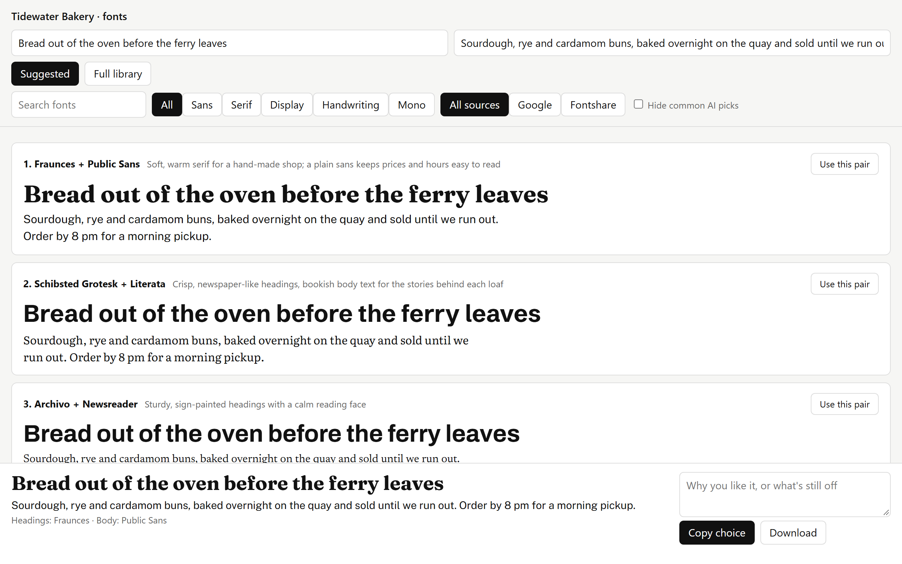
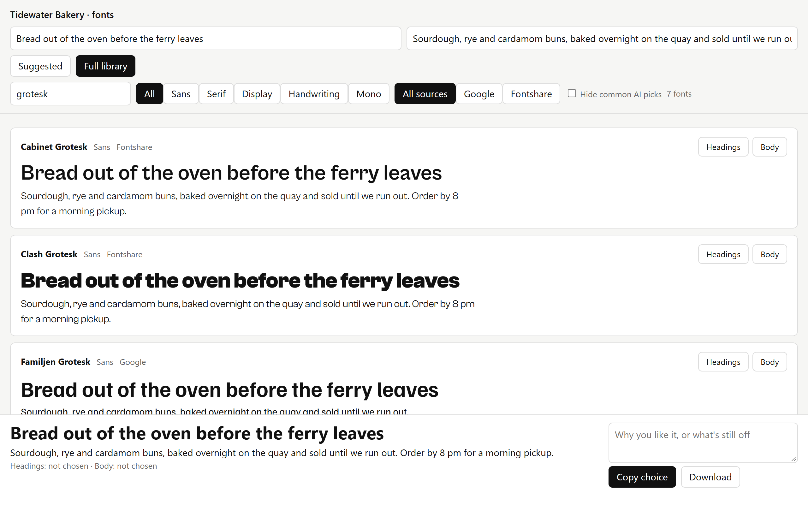
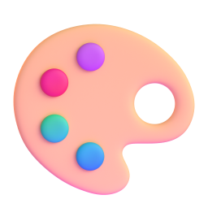
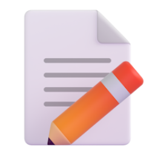
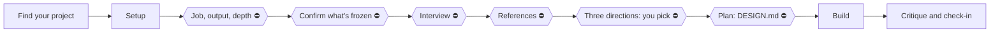

<p align="center">
  
</p>

<h1 align="center">design-studio</h1>

<p align="center">Makes Claude design like a real designer. It asks what you want, shows you options to pick from, and only then builds.</p>

<p align="center">
  <a href="CHANGELOG.md"></a>
  <a href="https://github.com/Aydin-codes/design-studio/actions/workflows/ci.yml"></a>
  <a href="#install"></a>
  <a href="LICENSE"></a>
</p>

<p align="center">
  <a href="#install"><b>Install</b></a> ·
  <a href="#see-it-work">See it work</a> ·
  <a href="#how-it-works">How it works</a> ·
  <a href="https://github.com/Aydin-codes/toolkit">Toolkit</a> ·
  <a href="CHANGELOG.md">Changelog</a>
</p>

<p align="center">If design-studio helps you, please give it a star ⭐</p>

<p align="center">
  <picture>
    <source media="(prefers-color-scheme: dark)" srcset=".github/assets/font-picker-dark.png">
    
  </picture>
</p>
<p align="center"><sub>Choosing fonts for a sample bakery site. Claude suggests three pairings on the site's own words, you pick one, and your choice goes back into the chat.</sub></p>

## What it is

When you ask an AI to design a page, it usually starts coding straight away, and you get the page everyone gets: a purple gradient, a small label over a big headline, "Trusted by 10,000+ teams" and the Inter font.

design-studio is a skill you add to Claude (it also works in Cursor, Codex and other AI coding tools). It makes the AI work the way a designer works with a client. It asks what you're making and what you like. It shows you three real directions to choose from. It writes down the plan you agreed on, builds only that, and checks the result before it says it's done. It also remembers your taste for the next project.

It works for websites, app screens, dashboards, reports, printable PDFs and game screens. You don't need to know any design words: you react to what you see, and it tells you what the thing you liked is called.

## See it work

<table>
  <tr>
    <td width="50%"></td>
    <td width="50%"></td>
  </tr>
  <tr>
    <td><sub><b>A typical AI page.</b> We wrote this sample the way AI tools usually do, to test the checks. Nothing on it came from a real client.</sub></td>
    <td><sub><b>design-studio catches it.</b> Its check script found 14 problems in that page, including the made-up "10,000+ teams" and leftover "Lorem ipsum".</sub></td>
  </tr>
  <tr>
    <td></td>
    <td><picture><source media="(prefers-color-scheme: dark)" srcset=".github/assets/font-library-dark.png"></picture></td>
  </tr>
  <tr>
    <td><sub><b>It can't skip steps.</b> In Claude Code, if Claude tries to edit your app before you've picked a direction, the edit is blocked and Claude is told exactly what's missing.</sub></td>
    <td><sub><b>You choose, not the AI.</b> Beyond Claude's suggestions you can search all 1,938 Google and Fontshare fonts, each shown on your own words.</sub></td>
  </tr>
</table>

## How it works

|  |  |  |  |
|:-:|:-:|:-:|:-:|
| **1. Talk**<br>What you're making, what must stay the same, what you like and hate | **2. Pick**<br>Three real directions. Pick one, mix them, or say no to all three | **3. Plan**<br>The plan you agreed on goes into `DESIGN.md`, so nothing gets lost | **4. Build and check**<br>It builds only what you picked, then checks for AI tells and your dislikes |

Every reply starts with the step it's on, and it stops and waits for you at each decision. You choose how much of your time it takes: **Light** (about 2 minutes), **Moderate** (about 10, the default) or **Deep** (30 or more).

<details>
<summary><b>See all nine steps</b></summary>



⛔ marks a stop where Claude waits for your answer.

</details>

## Install

In Claude Code (this includes the automatic checks):

```
/plugin marketplace add Aydin-codes/design-studio
/plugin install design-studio@design-studio
```

<details>
<summary><b>Other tools</b></summary>

**Any agent that supports skills:**
```
npx skills add Aydin-codes/design-studio
```

**Claude app:** zip the `skills/design-studio` folder and upload it under Customize → Skills → Upload a skill (code execution must be on).

**Anything else:** copy `skills/design-studio/` into your project and point your AI at `SKILL.md`.

</details>

## Use

Type `/design-studio` and say what you want, or just ask for a design in your own words:

```text
/design-studio a landing page for my bakery
/design-studio reskin this dashboard, keep how everything works
/design-studio polish the pricing page
/design-studio fix the hero, it looks AI-made
```

It starts by asking what the job is, what you're making and how much time you want to spend.

## What you can ask for

| Job | Keeps | Changes |
|---|---|---|
| New | nothing (unless you say so) | everything |
| Rebrand | layout, flows, content | look, type, color, voice |
| Reskin | how everything works (UX) | how it looks (UI) |
| Redesign | content and goals | layout and look |
| Polish | everything you have | the details |
| Fix a part | everything else | one section you point at |

It shows what it will keep and change, and you confirm before anything happens. Then it asks what matters most: **how it looks, how it works, or both.** Pick "works" and it skips the taste questions and spends your time on tasks, steps and clarity instead.

## Works in

| | Tool | What you get |
|:-:|---|---|
| <picture><source media="(prefers-color-scheme: dark)" srcset=".github/assets/logos/claude-dark.svg"></picture> | Claude Code | Everything, and the checks run by themselves through hooks |
| <picture><source media="(prefers-color-scheme: dark)" srcset=".github/assets/logos/claude-dark.svg"></picture> | Claude app | The full skill; the checks run when the AI runs them |
| <picture><source media="(prefers-color-scheme: dark)" srcset=".github/assets/logos/cursor-dark.svg"></picture> | Cursor | The full skill; the checks run when the AI runs them |
|  | Codex and other tools that read `SKILL.md` | The full skill; the checks run when the AI runs them |

## More of what it does

<details>
<summary><b>It remembers your taste</b></summary>

- **Open talk first.** Every run starts by asking about sites you love and why, and what you hate. All of it goes into your taste profile, and your dislikes become rules straight away.
- **Rules you confirm.** Likes and dislikes are saved with how strongly you feel and where they apply. Patterns that repeat become suggested rules, at most 3 per session, asked at the end. You keep up to 15.
- **Review board.** Directions open in a page where you switch between them, mark each Pick, Take parts or Reject, and write notes. "Copy feedback" pastes them back to the AI, so it works with any tool.
- **Fix one part.** Point at a section ("this looks AI-made") and it locks the rest, says what's wrong in plain words, and shows three fixes for just that part.
- **Other skills.** If other design skills or rules files are loaded, it tells you which could conflict and asks which one wins.

The profile is saved as `.studio/taste-profile.md` in your project, or `~/.studio/taste-profile.md` for all your projects.

</details>

<details>
<summary><b>The checks, in detail</b></summary>

1. **Short core, branch files.** `SKILL.md` is about 90 lines. The detail for each job, output and step lives in its own file, opened only when that path comes up.
2. **State file.** The skill keeps `.studio/state.json` in your project: the step, the job, whether you confirmed what's frozen, and your pick.
3. **A check script** (`scripts/check.mjs`, Node, no dependencies):
   - Won't let it edit UI files before you've confirmed the job, picked a direction and the plan exists.
   - Won't let it finish before the critique is done.
   - Scans the built files for known AI tells (placeholders, invented reviews, default fonts, eyebrow labels, design notes left on the page).
   - Does nothing in projects where design-studio isn't active.

There's also an optional [GitHub workflow](skills/design-studio/templates/github-workflow.yml) that checks `DESIGN.md` on every push.

</details>

<details>
<summary><b>Expert packs</b></summary>

Expert skills you switch on per project; only what you enable gets loaded. See [packs.md](skills/design-studio/reference/packs.md).

| Pack | From | For |
|---|---|---|
| `emil` | Emil Kowalski | Motion, feel, variant picker, stress tests |
| `impeccable` | Paul Bakaus | Critique and polish of existing UI |
| `motion` | GSAP, Motion, Three.js, Rive, Lottie | Motion identity for landing pages and games |
| `native-apple` | Apple HIG skills | Native iOS and macOS apps |

Fonts, icons, photos and other assets come from the [toolkit](https://github.com/Aydin-codes/toolkit), which ships with this plugin.

</details>

<details>
<summary><b>Finding your way around the repo</b></summary>

```
.claude-plugin/          plugin and marketplace manifests
hooks/hooks.json         Claude Code hooks that run the checks
agents/design-critic.md  fresh-eyes reviewer that sees only screenshots and the plan
tests/                   tests for the check script (node --test)
skills/toolkit/          copy of github.com/Aydin-codes/toolkit: stacks, libraries and asset sources, with licences
skills/color-and-type-spark/  live picking sheets for colors and fonts
skills/design-studio/
├── SKILL.md             the core: rules and the nine steps
├── jobs/                new, rebrand, reskin, redesign, polish, fix a part
├── outputs/             landing, app, dashboard, report, print, game
├── reference/           one file per step, plus craft, motion and tells
├── scripts/check.mjs    the checks
├── sources/             expert rules, credited
└── templates/           state, taste profile, review board, font picker, GitHub workflow
```

In your project it writes `DESIGN.md` (the plan) and `.studio/` (state, critique, taste profile).

</details>

## Built with

| | | What it does here |
|:-:|---|---|
|  | [Node.js](https://nodejs.org) | Runs the check script. No packages to install |
|  | [GitHub Actions](https://github.com/features/actions) | Runs the tests on Windows, macOS and Linux on every push |
|  | [toolkit](https://github.com/Aydin-codes/toolkit) | The list of real fonts, icons and assets it pulls from |

## Current limits

- It's early: v0.13, tried on a handful of projects. Feedback and issues are welcome.
- The automatic checks only run in Claude Code. In other tools they depend on the AI running them.
- Mobbin's connector needs a paid plan; without it the skill uses free galleries.
- It can't watch YouTube; new design sources come in as transcripts or screenshots.

## Contributing

Found a step it skipped, or a page that still looks AI-made? [Open an issue](https://github.com/Aydin-codes/design-studio/issues/new/choose). Pull requests are welcome; [CONTRIBUTING.md](CONTRIBUTING.md) has the rules. Report security problems privately, as [SECURITY.md](SECURITY.md) explains.

## License

MIT. See [LICENSE](LICENSE).

<sub>Built on ideas and skills from Emil Kowalski (MIT), Paul Bakaus's Impeccable, Anthropic's <code>frontend-design</code>, Kole Jain's design videos, Mobbin's dashboard study and the raintree Apple HIG skills; expert skills are called, not copied. Icons from Microsoft <a href="https://github.com/microsoft/fluentui-emoji">Fluent Emoji</a> (MIT) and <a href="https://simpleicons.org">Simple Icons</a> (CC0). The bakery and "Flowly" are made-up examples.</sub>
